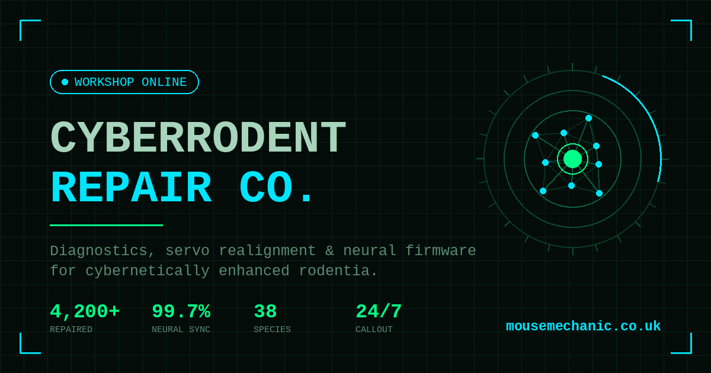

<div align="center">



# CyberRodent Repair Co.

**A fully-realised cybernetic rodent repair workshop that does not exist.**

[**Visit the workshop →**](https://mousemechanic.co.uk)

</div>

---

## What this is

A single-page site for a fictional 2030s repair shop specialising in cybernetically
augmented rodents. It started as an excuse to build interactive components without
the usual constraint of the content being useful, and got somewhat out of hand.

Everything on it works. The diagnostic scanner really does branch on your inputs.
The cost estimator really does calculate. The AI assistant really is an LLM, and
really will try to sell you a whisker recalibration.

## Features

**Interactive diagnostic scanner** — four-stage flow: pick a species, multi-select
observed symptoms, watch a fake scan progress, receive a generated fault report
with recommended services. Branching logic per species/symptom combination.

**Anatomy schematic** — clickable SVG map of a cybernetic rodent. Seven hotspots
(neural core, optical array, whiskers, power cell, front/rear servos, comms tail),
each surfacing technical detail and linked services.

**Cost estimator** — species × services × urgency tier, with live total. Emergency
callout applies a 60% surcharge, because of course it does.

**REX-7, the workshop AI assistant** — a chat widget backed by the Claude API,
prompted with the workshop's own knowledge base. Stays in character. Will discuss
your hamster's tail-actuator recall in detail.

**Live repair tracker** — active bays, queue depth and a scrolling workshop event
log, generated client-side.

## Stack

| | |
|---|---|
| **Hosting** | Cloudflare Pages |
| **API layer** | Cloudflare Workers |
| **AI assistant** | Claude API (Anthropic) |
| **Front-end** | Vanilla HTML/CSS/JS — no framework |
| **Graphics** | Hand-authored SVG |

No build step. No dependencies. One HTML file and a Worker (`worker/`).

## Running locally

```bash
git clone https://github.com/iamsidge/cyberrodent.git
cd cyberrodent

# Static preview — the site runs, REX-7 won't
python3 -m http.server 8000

# The Worker, with a key in worker/.dev.vars (ANTHROPIC_API_KEY=...)
cd worker && npx wrangler dev
```

The page talks to the Worker at its live address; point `CHAT_API_URL` in
`index.html` at `http://localhost:8787` to chat through a local one.

## REX-7's Worker

`worker/` is the `rex7-proxy` Worker. The page sends it only the conversation;
the model, reply length and REX-7's system prompt are fixed in the Worker, so
it can't be used as a general Claude API on the workshop's key. It also:

- answers only mousemechanic.co.uk, its www, cyberrodent-repair.pages.dev and
  localhost (other websites can't use it from a browser);
- takes at most 20 messages of up to 1,000 characters, 8,000 in all, as plain
  text, alternating user and assistant and ending with the user;
- allows each visitor IP 10 messages a minute (`[[ratelimits]]` in
  `wrangler.toml`);
- returns just `{ reply }`, and keeps Claude API errors in the Worker's logs.

The Origin check doesn't stop scripts, which can send any Origin they like: the
caps and the rate limit are what bound the cost.

## Deploying

```bash
# The site
npx wrangler pages deploy . --project-name=cyberrodent-repair

# The Worker, and its key as a secret
cd worker
npx wrangler deploy
npx wrangler secret put ANTHROPIC_API_KEY
```

## Notes

The recall notice on the Hamster Mk9 tail-actuators is not real. Please do not
contact the workshop about it. There is no workshop.

Off-brand whisker sensors do, however, void the warranty.

## Licence

MIT. Take the code, leave the rodents.
